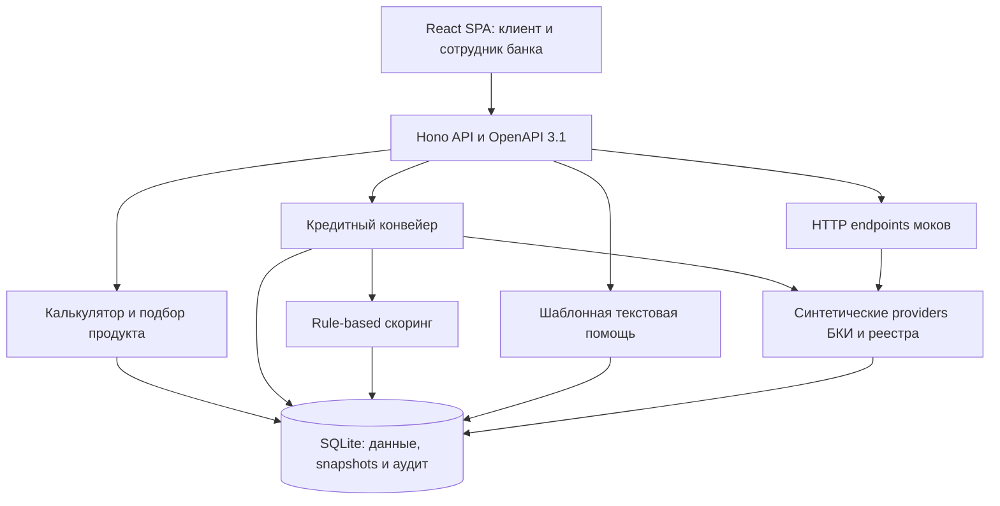
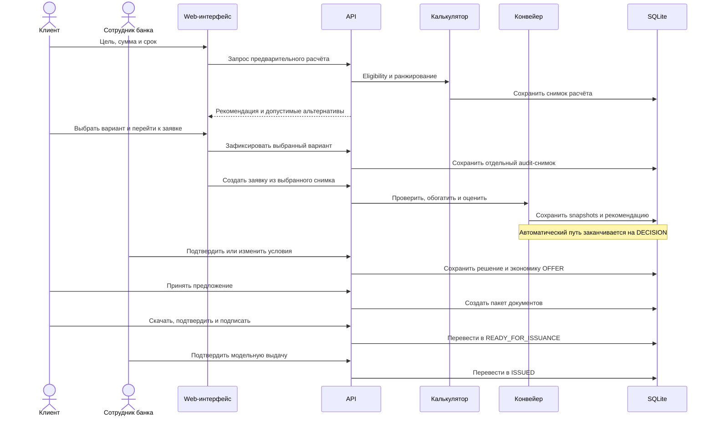
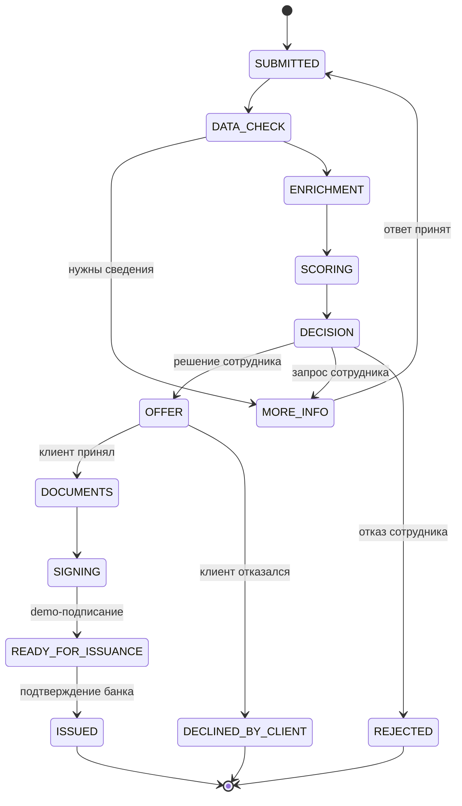
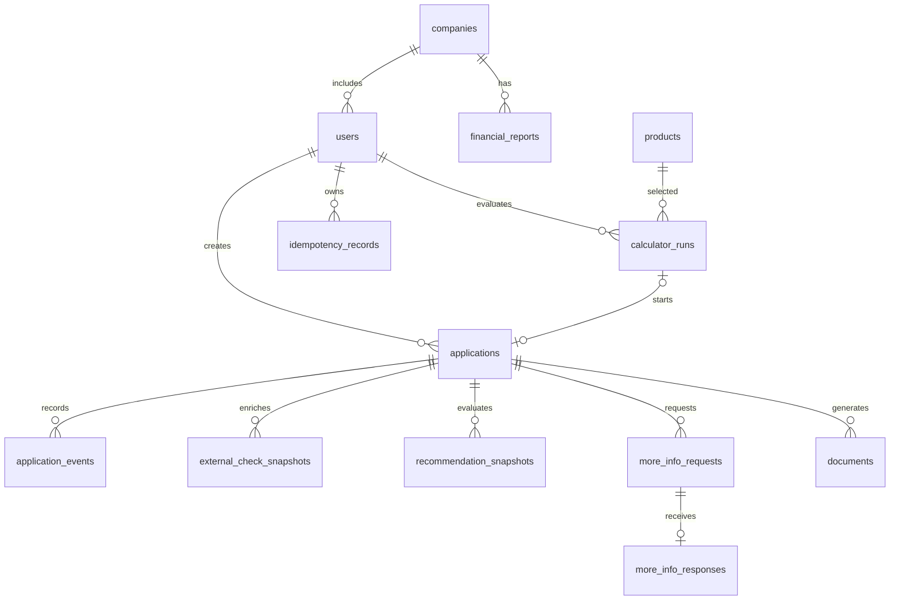

# Архитектура решения

## Принципы

- Один воспроизводимый контейнер для web, API и SQLite.
- Основная бизнес-логика и проверки выполняются на сервере; frontend отображает серверное состояние.
- Автоматический конвейер формирует рекомендацию, но финальное кредитное решение принимает сотрудник банка.
- Предварительный расчёт, решение, документы и события сохраняются как отдельные аудируемые снимки.
- Критические команды идемпотентны, а неизвестный сетевой результат сверяется безопасным чтением.
- Демо автономно: внешние API, платные сервисы и AI-runtime не требуются.
- Целевая среда проверки — офисный ПК с 8–16 ГБ RAM без дискретной видеокарты; вычисления выполняются на CPU.

## Компоненты

Конвейер и HTTP endpoints моков используют общие in-process provider-реализации. Сервер не вызывает собственные HTTP endpoints для внутренних проверок.

| Слой | Реализация | Ответственность |
|---|---|---|
| Web | React 19, TypeScript, Vite, Tailwind, локальные компоненты на Radix UI | Клиентский кабинет и банковский бэкофис |
| API | Hono, Zod, `@hono/zod-openapi` | Валидация, RBAC, маршруты и единый error envelope |
| Бизнес-логика | Калькулятор, eligibility, conveyor, scoring | Подбор, проверки, состояния, оценка риска и экономика |
| Данные | better-sqlite3, WAL, транзакции | Заявки, snapshots, документы, события и идемпотентность |
| Интеграции | Локальные synthetic providers | Контракты БКИ и ЕГРЮЛ/ЕГРИП без внешней сети |
| Текстовая помощь | Детерминированные шаблоны | Ответы клиенту и саммари досье без ИИ |

## Сквозной процесс

## Состояния заявки

`DECISION` означает, что предварительная рекомендация готова и ожидает человека. Это не автоматическое одобрение. Клиент видит понятный timeline и следующий шаг, а техническая история хранит все переходы, время, роль и комментарий.

## Подбор, скоринг и решение

Три расчётных уровня разделены:

1. **Предварительный калькулятор** до заявки фильтрует продукты по цели, выручке, сумме и сроку, затем показывает рекомендацию и допустимые альтернативы. Клиент может принять рекомендацию или выбрать предложенную альтернативу; сервер создаёт для выбора отдельный audit-снимок, поэтому заявка не расходится с показанной карточкой.
2. **Внутренний скоринг** после заявки рассчитывает объяснимую оценку риска и рекомендацию сотруднику.
3. **Решение сотрудника** подтверждает, изменяет условия, запрашивает сведения или отказывает. Только оно создаёт `OFFER`.

Балльная карта `rule-based-v1` использует семь факторов: возраст компании, выручку, финансовый результат, показатель БКИ, платёжную дисциплину, долговую нагрузку и отношение суммы к выручке. Баллы и класс A–D доступны только банковской роли. Для положительного решения клиентская отчётность должна быть подтверждена сотрудником.

При изменении продукта, суммы или срока сервер повторно проверяет eligibility и рассчитывает внутренний риск по финальным условиям, не переписывая первичную оценку. Для каждой показанной альтернативы сервер отдельно рассчитывает ставку, платёж, переплату, общую выплату и индекс соответствия правилам; индекс не является вероятностью одобрения.

## Экономика предложения

Сервер сохраняет единый снимок финального предложения:

- продукт и основной долг;
- номинальную годовую ставку и срок;
- аннуитетный ежемесячный платёж;
- общую выплату и переплату;
- срок действия предложения;
- признак включения комиссий;
- исходные условия калькулятора для сравнения.

При месячной ставке `r = rate / 12 / 100` и сроке `n` платёж рассчитывается как `P × r × (1+r)^n / ((1+r)^n−1)`. UI, confirmation dialog, документы и итоговый экран используют этот серверный снимок без локального пересчёта.

Комиссии, страхование, штрафы и ПСК в демо не моделируются. Продуктовые диапазоны и ставки являются синтетическими допущениями прототипа, а не актуальными условиями банка.

## Надёжность и безопасность

- Роли `CLIENT` и `BANK` проверяются на каждом защищённом endpoint; клиент дополнительно проверяется как владелец заявки и документа.
- `/api/assistant` доступен только роли `CLIENT`; контекст и история привязываются только к собственной заявке, банковской роли клиентский чат не возвращается, длина сообщения ограничена.
- Сессия хранится в `HttpOnly`, `SameSite=Lax` cookie; `Secure` включается конфигурацией при HTTPS.
- Вход имеет rate limit, ответы содержат `Cache-Control: no-store` и базовые защитные заголовки.
- Подача заявки, принятие/отказ, ознакомление, подписание, банковское решение и выдача требуют `Idempotency-Key`.
- Повтор команды с тем же ключом и payload возвращает сохранённый результат; конфликт ключа даёт `409`.
- При timeout или сетевой ошибке frontend не повторяет POST автоматически, а выполняет GET reconciliation и сохраняет последний успешный снимок.
- Необратимые действия требуют confirmation dialog со значимыми параметрами; «Отмена» не вызывает мутацию.
- Error Boundary заменяет белый экран понятным вариантом восстановления.

## Данные и аудит

Ключевые решения сохраняются как snapshots: исходный расчёт, ответы внешних проверок, версии рекомендаций, использованная финансовая отчётность, финальное предложение и версии документов с SHA-256. Схема обновляется транзакционными миграциями, а синтетический seed версионирован, вычисляет актуальные отчётные периоды от UTC-года и не перезаписывает пользовательские данные.

## API и проверяемость

`server/app.ts` содержит API-приложение, а `server/index.ts` только запускает HTTP-сервер. Спецификация OpenAPI 3.1 доступна по `/openapi.json`, интерактивная Scalar-документация — по `/api/docs`. Все 32 операции имеют уникальные `operationId`, схемы ответов и общий JSON-формат ошибок.

Проверки включают unit/integration-тесты бизнес-логики, HTTP/RBAC-сценарии, contract-тест OpenAPI, browser E2E полного процесса и axe accessibility smoke.

## Граница демо и production

| В демо | Для production |
|---|---|
| SQLite и один экземпляр | PostgreSQL/HA, backup/DR и наблюдаемость |
| Синтетические providers БКИ/реестра | Защищённые интеграции, согласия и аудит запросов |
| Demo-auth и две роли | IAM/SSO, MFA, ABAC и maker/checker |
| Rule-based scorecard | Валидированная риск-методология и model risk management |
| Локальные `.txt`-документы | Юридические шаблоны и защищённое объектное хранилище |
| Моделируемое подписание | Сертифицированный провайдер ЭП и доказательная база |
| Статус `ISSUED` | АБС, счёт, проводки и reconciliation денежных операций |
| SQLite-idempotency | Распределённая идемпотентность, outbox и очереди |
| Шаблонный помощник | При необходимости ИИ — DLP, guardrails и контроль качества |

Подробное происхождение компонентов и данных приведено в [`../THIRD_PARTY_NOTICES.md`](../THIRD_PARTY_NOTICES.md).
