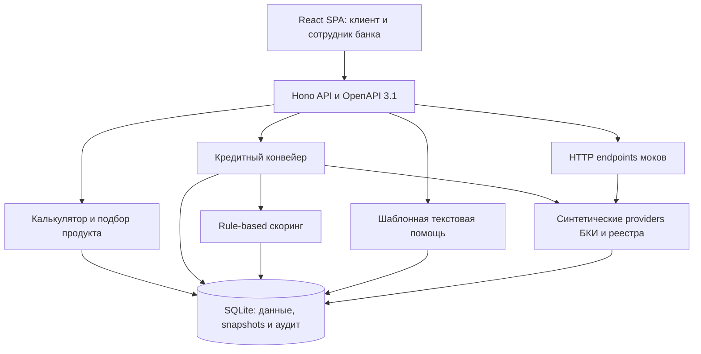
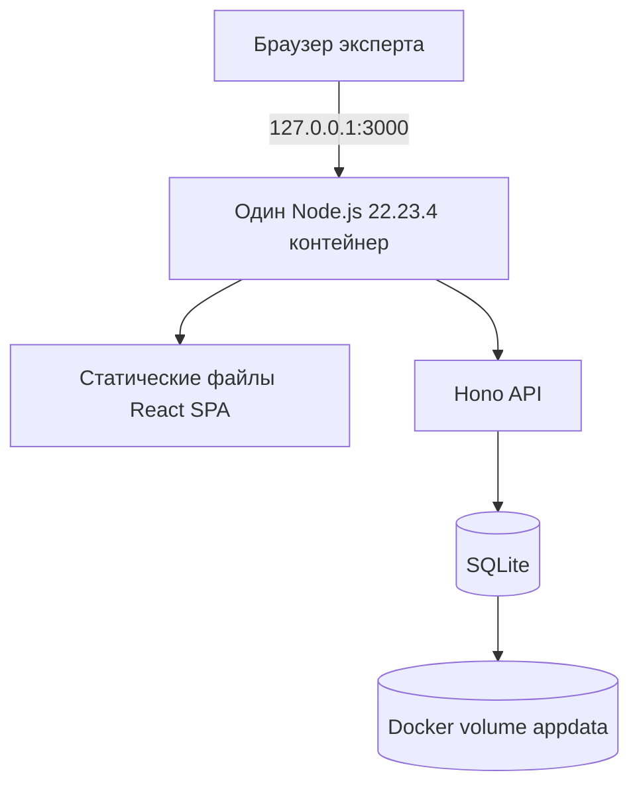
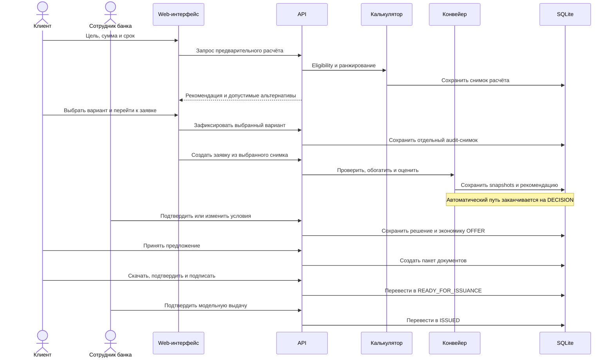
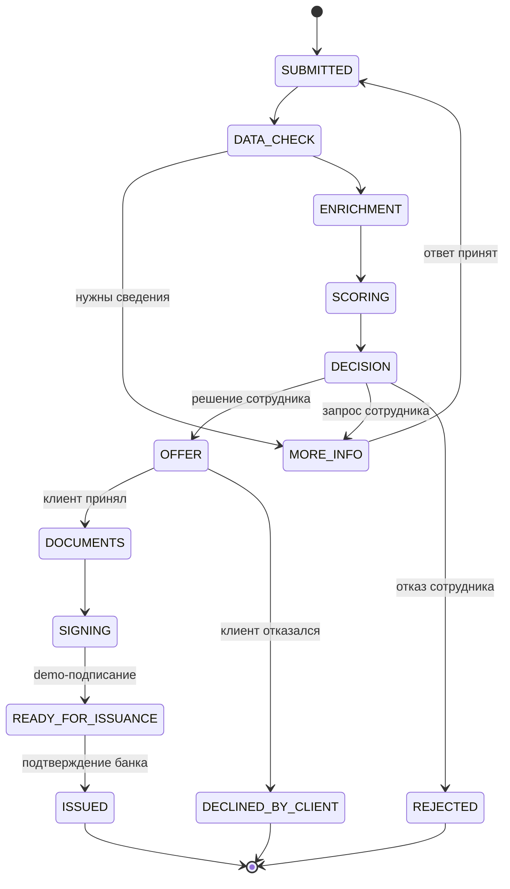
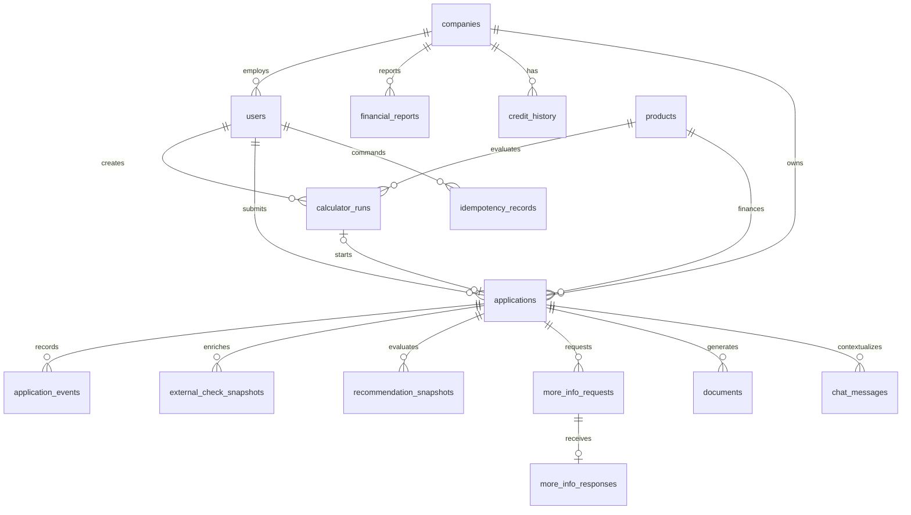

# Архитектура решения

## Принципы

- Один воспроизводимый контейнер для web, API и SQLite.
- Основная бизнес-логика и проверки выполняются на сервере; frontend отображает серверное состояние.
- Автоматический конвейер формирует рекомендацию, но финальное кредитное решение принимает сотрудник банка.
- Предварительный расчёт, решение, документы и события сохраняются как отдельные аудируемые снимки.
- Критические команды идемпотентны, а неизвестный сетевой результат сверяется безопасным чтением.
- Демо автономно: внешние API, платные сервисы и AI-runtime не требуются.
- Целевая среда проверки — офисный ПК с 8–16 ГБ RAM без дискретной видеокарты; вычисления выполняются на CPU.

## Компоненты

Конвейер и HTTP endpoints моков используют общие in-process provider-реализации. Сервер не вызывает собственные HTTP endpoints для внутренних проверок.

| Слой | Реализация | Ответственность |
|---|---|---|
| Web | React 19, TypeScript, Vite, Tailwind, локальные компоненты на Radix UI | Клиентский кабинет и банковский бэкофис |
| API | Hono, Zod, `@hono/zod-openapi` | Валидация, RBAC, маршруты и единый error envelope |
| Бизнес-логика | Калькулятор, eligibility, conveyor, scoring | Подбор, проверки, состояния, оценка риска и экономика |
| Данные | better-sqlite3, WAL, транзакции | Заявки, snapshots, документы, события и идемпотентность |
| Интеграции | Локальные synthetic providers | Контракты БКИ и ЕГРЮЛ/ЕГРИП без внешней сети |
| Текстовая помощь | Детерминированные шаблоны | Ответы клиенту и саммари досье без ИИ |

## Runtime и развёртывание

`docker compose up --build` собирает web и server на закреплённом по digest образе Node.js `22.23.4`, запускает один экземпляр приложения от непривилегированного пользователя, применяет миграции и создаёт seed только в пустой БД. Порт публикуется на loopback-интерфейсе, а состояние хранится вне контейнера. Горизонтальное масштабирование с SQLite не заявляется: для production потребуется внешняя HA-БД и распределённые механизмы координации.

## Сквозной процесс

## Состояния заявки

`DECISION` означает, что предварительная рекомендация готова и ожидает человека. Это не автоматическое одобрение. Клиент видит понятный timeline и следующий шаг, а техническая история хранит все переходы, время, роль и комментарий.

## Подбор, скоринг и решение

Три расчётных уровня разделены:

1. **Предварительный калькулятор** до заявки фильтрует продукты по цели, выручке, сумме и сроку, затем показывает рекомендацию и допустимые альтернативы. Клиент может принять рекомендацию или выбрать предложенную альтернативу; сервер создаёт для выбора отдельный audit-снимок, поэтому заявка не расходится с показанной карточкой.
2. **Внутренний скоринг** после заявки рассчитывает объяснимую оценку риска и рекомендацию сотруднику.
3. **Решение сотрудника** подтверждает, изменяет условия, запрашивает сведения или отказывает. Только оно создаёт `OFFER`.

Балльная карта `rule-based-v1` использует семь факторов: возраст компании, выручку, финансовый результат, показатель БКИ, платёжную дисциплину, долговую нагрузку и отношение суммы к выручке. Баллы и класс A–D доступны только банковской роли. Для положительного решения клиентская отчётность должна быть подтверждена сотрудником.

При изменении продукта, суммы или срока сервер повторно проверяет eligibility и рассчитывает внутренний риск по финальным условиям, не переписывая первичную оценку. Для каждой показанной альтернативы сервер отдельно рассчитывает ставку, платёж, переплату, общую выплату и индекс соответствия правилам; индекс не является вероятностью одобрения.

### Eligibility продукта

Вариант попадает в рекомендацию или альтернативы, только если одновременно выполнены ограничения продукта по минимальной/максимальной сумме, сроку, категории цели и минимальной годовой выручке. Границы суммы и срока включаются. Если точного совпадения нет, система может предложить ближайшие допустимые сумму и срок; неподходящий продукт рекомендованным не называется.

| Код | Продукт | Сумма | Срок | Ставка от | Мин. выручка | Допустимые категории цели |
|---|---|---:|---:|---:|---:|---|
| `express` | Экспресс-кредит | 100 тыс.–3 млн ₽ | 3–12 мес. | 19,9% | 0 ₽ | оборотные средства, закупка товара, налоги |
| `working_capital` | Оборотный кредит | 500 тыс.–30 млн ₽ | 6–36 мес. | 16,5% | 3 млн ₽ | оборотные средства, закупка сырья, аренда, зарплата |
| `investment` | Инвестиционный кредит | 1–150 млн ₽ | 12–84 мес. | 14,9% | 10 млн ₽ | оборудование, ремонт, расширение, проект |
| `overdraft` | Овердрафт | 100 тыс.–5 млн ₽ | 3–24 мес. | 21,0% | 0 ₽ | оборотные средства, резерв, налоги |

Ставки, диапазоны и категории целей — синтетические продуктовые допущения прототипа, зафиксированные для demo-каталога на `2026-10-23`. Это не публичные условия Альфа-Банка и не результат рыночного исследования. Источник истины исполняемого каталога — `server/seed.ts`.

### Предварительный калькулятор

Итоговая ориентировочная ставка складывается из базовой ставки продукта и детерминированных корректировок:

| Фактор | Условие | Корректировка |
|---|---|---|
| БКИ, `x` | `x ≥ 750` / `650 ≤ x < 750` / `550 ≤ x < 650` / `x < 550` | `0` / `+1` / `+2,5` / `+5` п.п. |
| Просрочки | `overdueCount = 0` / `overdueCount > 0` и `worstDelayDays ≤ 30` / `overdueCount > 0` и `worstDelayDays > 30` | `0` / `+1,5` / `+4` п.п. |
| ПДН, `x` | `x ≤ 30%` / `30% < x ≤ 50%` / `x > 50%` | `0` / `+1,5` / `+4` п.п. |
| Динамика выручки, `x` | `x ≥ 10%` / `0% ≤ x < 10%` / `−15% < x < 0%` / `x ≤ −15%` / нет истории | `−0,5` / `0` / `+1,5` / `+3` / `+0,5` п.п. |

Сумма корректировок применяется к базовой ставке, но итоговая ставка не опускается ниже базовой ставки продукта.

Индекс соответствия равен `round(clamp(score, 0, 105) / 105 × 100)`. Уровни: `HIGH` от 80, `MEDIUM` от 50, иначе `MANUAL_REVIEW`. Это нормированный индекс прохождения правил, а не вероятность одобрения.

### Внутренняя scorecard `rule-based-v1`

| Фактор | Баллы |
|---|---|
| Возраст бизнеса, `x` | `x ≥ 5 лет: +15`; `3 ≤ x < 5: +10`; `1 ≤ x < 3: +5`; `x < 1: 0` |
| Годовая выручка, `x` | `x ≥ 50 млн: +20`; `10 млн ≤ x < 50 млн: +15`; `3 млн ≤ x < 10 млн: +10`; `1 млн ≤ x < 3 млн: +5`; `x < 1 млн: 0` |
| Финансовый результат, `x` | `x > 0: +10`; `−1 млн < x ≤ 0: 0`; `x ≤ −1 млн: −10` |
| БКИ, `x` | `x ≥ 750: +25`; `650 ≤ x < 750: +15`; `550 ≤ x < 650: +5`; `x < 550: −10` |
| Просрочки | `overdueCount = 0: +15`; `overdueCount > 0` и `worstDelayDays ≤ 30: 0`; `overdueCount > 0` и `worstDelayDays > 30: −25` |
| ПДН, `x` | `x ≤ 30%: +10`; `30% < x ≤ 50%: 0`; `x > 50%: −15` |
| Сумма / годовая выручка, `x` | `x ≤ 50%: +10`; `50% < x ≤ 100%: +5`; `x > 100%: −10` |

Классы: `A: score ≥ 85`, `B: 70 ≤ score < 85`, `C: 50 ≤ score < 70`, `D: score < 50`. Полные баллы и класс видит только банковская роль; клиент получает публичные факторы без внутренних points.

### Рекомендация и решение

| Условие | Автоматическая рекомендация сотруднику |
|---|---|
| Нет актуальной финансовой отчётности | `MORE_INFO` |
| Класс `A` | `APPROVE`: запрошенные сумма/срок, базовая ставка |
| Класс `B` | `APPROVE`: запрошенные сумма/срок, базовая ставка `+1,5` п.п. |
| Класс `C` | `CONDITIONS`: не более 50% выручки, срок не более 24 месяцев, ставка `+3` п.п.; границы продукта сохраняются |
| Класс `D` | `REJECT` или ручной поиск альтернативных условий |

Это рекомендация, а не автоматическое кредитное решение. Сотрудник проверяет досье, может выбрать `APPROVE`, `CONDITIONS`, типизированный `MORE_INFO` или `REJECT`; сервер повторно проверяет продуктовые ограничения и ставку.

## Экономика предложения

Сервер сохраняет единый снимок финального предложения:

- продукт и основной долг;
- номинальную годовую ставку и срок;
- аннуитетный ежемесячный платёж;
- общую выплату и переплату;
- срок действия предложения;
- признак включения комиссий;
- исходные условия калькулятора для сравнения.

При месячной ставке `r = rate / 12 / 100` и сроке `n` платёж рассчитывается как `P × r × (1+r)^n / ((1+r)^n−1)`. UI, confirmation dialog, документы и итоговый экран используют этот серверный снимок без локального пересчёта.

Комиссии, страхование, штрафы и ПСК в демо не моделируются. Продуктовые диапазоны и ставки являются синтетическими допущениями прототипа, а не актуальными условиями банка.

## Надёжность и безопасность

- Роли `CLIENT` и `BANK` проверяются на каждом защищённом endpoint; клиент дополнительно проверяется как владелец заявки и документа.
- `/api/assistant` доступен только роли `CLIENT`; контекст и история привязываются только к собственной заявке, банковской роли клиентский чат не возвращается, длина сообщения ограничена.
- Сессия хранится в `HttpOnly`, `SameSite=Lax` cookie; `Secure` включается конфигурацией при HTTPS.
- Вход имеет rate limit, ответы содержат `Cache-Control: no-store` и базовые защитные заголовки.
- Подача заявки, принятие/отказ, ознакомление, подписание, банковское решение и выдача требуют `Idempotency-Key`.
- Повтор команды с тем же ключом и payload возвращает сохранённый результат; конфликт ключа даёт `409`.
- При timeout или сетевой ошибке frontend не повторяет POST автоматически, а выполняет GET reconciliation и сохраняет последний успешный снимок.
- Необратимые действия требуют confirmation dialog со значимыми параметрами; «Отмена» не вызывает мутацию.
- Error Boundary заменяет белый экран понятным вариантом восстановления.

## Данные и аудит

| Сущность | Назначение и жизненный цикл |
|---|---|
| `companies`, `users`, `sessions` | Синтетический профиль бизнеса, две роли и cookie-сессии |
| `products` | Демонстрационные диапазоны суммы/срока, ставка, цели и минимум выручки |
| `calculator_runs` | Неизменяемый вход и результат каждого расчёта; один выбранный снимок создаёт не более одной заявки |
| `applications` | Текущий агрегат заявки, статус, выбранные условия и финальное решение |
| `application_events` | Append-only история переходов с actor, временем и комментарием |
| `external_check_snapshots` | Ответ конкретной версии локального provider БКИ или реестра |
| `financial_reports` | Период, происхождение, статус проверки и связь с заявкой/проверяющим |
| `recommendation_snapshots` | Версия scorecard, факторы, предложение и использованная отчётность; старые версии не переписываются |
| `more_info_requests`, `more_info_responses` | Типизированный дозапрос, дедлайн, требуемые данные и единственный ответ |
| `documents` | Версия, SHA-256, факты открытия, ознакомления и моделируемого подписания |
| `idempotency_records` | Результат критической команды, привязанный к пользователю, операции, ключу и hash payload |
| `chat_messages` | Только контекст собственного клиентского помощника; банковской роли не выдаётся |
| `news`, `seed_metadata`, `schema_migrations` | Демонстрационный контент и версии seed/схемы |

Ключевые решения сохраняются как snapshots: исходный расчёт, ответы внешних проверок, версии рекомендаций, использованная финансовая отчётность, финальное предложение и версии документов с SHA-256. Схема обновляется транзакционными миграциями, а синтетический seed версионирован, вычисляет актуальные отчётные периоды от UTC-года и не перезаписывает пользовательские данные.

## API и проверяемость

`server/app.ts` содержит API-приложение, а `server/index.ts` только запускает HTTP-сервер. Все ответы JSON используют envelope `{ ok, data }` или `{ ok: false, error }`; загрузка документа возвращает `text/plain`. Авторизация основана на `HttpOnly` cookie.

| Группа | Основные маршруты | Доступ и назначение |
|---|---|---|
| Meta/Auth | `/api/health`, `/api/auth/*` | Health и demo-вход; login имеет rate limit |
| Products/Calculator | `/api/products`, `/api/calculator/evaluate`, `/api/calculator/runs/{id}` | Каталог публичен; расчёт и его снимок принадлежат клиенту |
| Client | `/api/client/profile`, `/api/applications/*`, `/api/documents/*`, `/api/assistant` | Профиль, заявка, ответы, документы и шаблонный помощник только клиента-владельца |
| Content | `/api/news` | Синтетическая лента; для вошедшего клиента порядок персонализируется по ОКВЭД |
| Bank | `/api/bank/queue`, `/api/bank/applications/{id}/*` | Очередь, досье, отчётность, решение и выдача только для `BANK` |
| Mocks | `/api/mocks/bki/{inn}`, `/api/mocks/egrul/{inn}` | Локальные синтетические контракты внешних проверок только для `BANK` |

Спецификация OpenAPI 3.1 доступна по `/openapi.json`, интерактивная Scalar-документация — по `/api/docs`. Все 32 операции имеют уникальные `operationId`; route-схемы одновременно валидируют фактические запросы. Исполнимая коллекция основного пути находится в [`api/credit-cabinet.http`](api/credit-cabinet.http).

Проверки включают unit/integration-тесты бизнес-логики, HTTP/RBAC-сценарии, contract-тест OpenAPI, browser E2E полного процесса и axe accessibility smoke.

## Граница демо и production

| В демо | Для production |
|---|---|
| SQLite и один экземпляр | PostgreSQL/HA, backup/DR и наблюдаемость |
| Синтетические providers БКИ/реестра | Защищённые интеграции, согласия и аудит запросов |
| Demo-auth и две роли | IAM/SSO, MFA, ABAC и maker/checker |
| Rule-based scorecard | Валидированная риск-методология и model risk management |
| Локальные `.txt`-документы | Юридические шаблоны и защищённое объектное хранилище |
| Моделируемое подписание | Сертифицированный провайдер ЭП и доказательная база |
| Статус `ISSUED` | АБС, счёт, проводки и reconciliation денежных операций |
| SQLite-idempotency | Распределённая идемпотентность, outbox и очереди |
| Шаблонный помощник | При необходимости ИИ — DLP, guardrails и контроль качества |

Подробное происхождение компонентов и данных приведено в [`../THIRD_PARTY_NOTICES.md`](../THIRD_PARTY_NOTICES.md).
