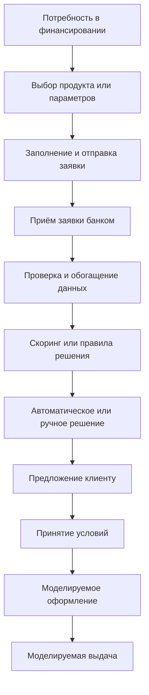

# Техническое задание

## Умный кредитный кабинет предпринимателя

**Версия:** 1.0  
**Статус:** требования, консолидированные по ответам организаторов на вебинаре  
**Тип решения:** проверяемый full-stack прототип кредитного конвейера для малого и микробизнеса

## 1. Назначение документа

Документ преобразует ответы организаторов в единое техническое задание. При трактовке требований используются следующие уровни обязательности:

- **должно / требуется** — обязательное требование MVP;
- **следует / рекомендуется** — желательное свойство, усиливающее решение;
- **может / допускается** — необязательная возможность;
- **не требуется** — функциональность не входит в обязательный объём.

Если команда принимает собственное продуктовое или техническое решение в области, не зафиксированной заданием, оно должно быть логичным, воспроизводимым и описанным в документации.

## 2. Цель решения

Разработать работающий кредитный кабинет, который связывает в одном сквозном процессе:

1. возникновение у предпринимателя потребности в финансировании;
2. подбор или формирование подходящего кредитного предложения;
3. подачу заявки действующим клиентом банка;
4. обработку заявки на стороне банка;
5. принятие кредитного решения;
6. принятие клиентом предложенных условий;
7. моделируемое завершение сделки и выдачу кредита.

Решение должно одновременно:

- упрощать клиенту получение финансирования;
- сокращать ручные действия, время и стоимость обработки заявки для банка;
- сохранять понятный и проверяемый путь заявки между клиентской и банковской сторонами.

Новизна и использование ИИ сами по себе не заменяют полноту основного кредитного сценария.

## 3. Границы проекта

### 3.1. Входит в обязательный MVP

- веб-интерфейс действующего клиента-предпринимателя;
- банковская сторона обработки заявки и интерфейс сотрудника банка;
- авторизация или иной документированный способ входа под тестовыми ролями;
- передача клиентом данных о компании через личный кабинет;
- создание, отправка и сохранение кредитной заявки;
- прохождение заявки по этапам с сохранением состояния;
- автоматическое и/или ручное принятие решения по правилам, выбранным командой;
- формирование предложения клиенту;
- принятие предложения клиентом;
- моделируемая выдача кредита;
- синтетические данные и автономные имитации банковских интеграций;
- локальный воспроизводимый запуск решения по инструкции.

### 3.2. Не входит в обязательный MVP

- регистрация нового юридического лица или нового клиента банка;
- сценарий физического лица, которое только планирует открыть бизнес;
- посткредитное обслуживание после выдачи;
- реальные денежные проводки;
- реальные интеграции с АБС, ДБО, Госключом, SMS, БКИ, государственными и иными внешними банковскими системами;
- обученная на реальных банковских данных ML-модель;
- LLM, AI-ассистент или ML-скоринг;
- загрузка и автоматическая обработка документов;
- OCR;
- прогноз кассового разрыва;
- мобильная версия;
- воспроизведение реальной продуктовой линейки Альфа-Банка;
- отдельные приложения для клиента и банка;
- презентация, видеопитч или видеозапись демонстрации для отборочного этапа.

### 3.3. Допустимые расширения

Команда может реализовать посткредитное обслуживание, документы, OCR, прогнозирование, дополнительные исходы заявки, расширенную ролевую модель, AI-функции и другие сервисы, если они:

- не заменяют обязательный кредитный конвейер;
- не нарушают основной сценарий;
- работают на синтетических данных;
- явно отделены от обязательного MVP;
- описаны вместе с принятыми допущениями.

## 4. Целевая аудитория

### 4.1. Клиенты

Целевая аудитория — действующие клиенты банка из числа:

- индивидуальных предпринимателей;
- юридических лиц, включая ООО;
- представителей малого и микробизнеса.

Количественные границы малого и микробизнеса заданием не установлены. При необходимости команда может определить сегмент на основании действующего законодательства и зафиксировать это допущение.

Различия между ИП и юридическими лицами требуется учитывать только там, где они влияют на состав данных, полномочия или маршрут кредитования. Отдельные кабинеты для каждой организационно-правовой формы не требуются.

### 4.2. Пользователи банка

Банковская роль представляет сотрудника, обрабатывающего кредитные заявки. Глубина разделения банковских полномочий определяется командой.

## 5. Роли и доступ

### AUTH-01. Клиент

Клиент должен иметь доступ к собственному профилю, продуктам или предложениям, своим заявкам, запросам банка, решениям и действиям по завершению сделки.

### AUTH-02. Сотрудник банка

Сотрудник банка должен иметь доступ к банковской очереди или эквивалентному представлению заявок, данным заявки, результатам проверок и предусмотренным командой действиям по обработке.

### AUTH-03. Разделение доступа

Клиентская и банковская информация должна быть разделена по ролям. Внутренние банковские сведения не должны автоматически раскрываться клиенту.

### AUTH-04. Авторизация

Регистрация пользователя не требуется. Команда самостоятельно выбирает способ авторизации и описывает его. Для проверки должны быть предоставлены тестовые учётные записи или другой однозначный способ входа под каждой ролью.

### AUTH-05. Расширенная ролевая модель

Разделение полномочий между собственником, директором, бухгалтером и сотрудником по доверенности необязательно. Если такие роли реализованы, их права и упрощения должны быть описаны.

Допускается одно веб-приложение с несколькими ролями; два отдельных приложения не требуются.

## 6. Обязательный сквозной сценарий

Состав промежуточных этапов команда определяет самостоятельно. Допускается объединять или упрощать этапы, если сохраняются связность процесса, состояние заявки и возможность проверить действия обеих сторон.

### FR-01. Определение потребности

Клиент должен иметь возможность указать потребность в финансировании и/или выбрать параметры кредита. Форма реализации определяется командой: каталог продуктов, калькулятор, мастер подбора, заявка с рекомендацией или иной понятный сценарий.

### FR-02. Кредитное предложение

Система должна предоставить клиенту подходящий продукт или условия на основании введённых либо заранее подготовленных данных. Продукты могут быть вымышленными, но их параметры должны соответствовать рыночной логике.

### FR-03. Данные клиента и компании

Клиент должен передавать необходимые для заявки данные через личный кабинет. Допускается предварительное заполнение профиля синтетическими данными действующего клиента.

Фиксированного перечня полей нет. Каждый собираемый параметр должен иметь понятное назначение в кредитном процессе.

### FR-04. Подача заявки

Клиент должен иметь возможность проверить параметры и явно отправить заявку. После отправки заявка должна быть сохранена и доступна обеим сторонам в пределах их прав.

### FR-05. Обработка банком

Банковская сторона должна получить заявку, просмотреть необходимое досье и выполнить предусмотренные этапы обработки. Полностью автоматическая обработка допускается только при наличии объяснённых правил и наблюдаемого результата; банковский интерфейс при этом остаётся обязательным.

### FR-06. Состояние и история заявки

Система должна:

- сохранять текущее состояние заявки;
- отражать движение по этапам;
- показывать клиенту актуальный статус в понятной форме;
- показывать банку сведения, необходимые для обработки;
- сохранять данные при переходах между состояниями.

Глубина раскрытия клиенту внутренних банковских этапов определяется командой.

### FR-07. Кредитное решение

Решение может приниматься системой, сотрудником или совместно. Команда должна описать:

- какие решения автоматизированы;
- где требуется участие человека;
- какие данные и правила влияют на результат;
- почему выбрано такое распределение ответственности.

### FR-08. Предложение клиенту

При положительном решении клиент должен увидеть предложенные сумму, срок, ставку и другие существенные условия, реализованные в продукте.

Способ объяснения предложения клиенту выбирает команда. При этом логика формирования результата должна быть прозрачна экспертам и прослеживаться от входных данных до решения.

### FR-09. Принятие предложения

Клиент должен иметь возможность принять предложение. Допускается также реализовать отказ клиента от предложения.

### FR-10. Завершение сделки

Демонстрационный сценарий не должен завершаться только экраном одобренных условий. После принятия предложения система должна показать моделируемое завершение оформления и факт выдачи кредита.

Реальное перечисление денежных средств не требуется.

### FR-11. Моделируемое подписание

Если в процессе используется подписание согласий или договора, его допускается реализовать кнопкой, внутренним кодом подтверждения или условной электронной подписью без SMS и внешних сервисов.

Интерфейс должен явно указывать, что подписание имеет демонстрационный характер. Описание будущей интеграции с ДБО или Госключом допускается как часть промышленной концепции.

## 7. Состояния и исходы заявки

Обязателен полностью работающий положительный путь от подачи заявки до моделируемой выдачи.

Конкретный набор альтернативных исходов не установлен. Допускается реализовать:

- запрос дополнительной информации;
- встречное предложение или изменённые условия;
- ручное рассмотрение;
- отказ банка;
- отказ клиента от предложения;
- повторную подачу.

Если альтернативные исходы реализованы, должны выполняться требования:

- переходы соответствуют описанной бизнес-логике;
- состояние и введённые данные не теряются;
- понятно, продолжается существующая заявка или создаётся новая;
- клиент получает понятное следующее действие;
- банковская сторона видит актуальное состояние.

## 8. Кредитные продукты и логика решения

### BR-01. Продуктовая линейка

Решение может использовать собственные кредитные продукты без привязки к действующей линейке Альфа-Банка.

### BR-02. Реалистичность условий

Ставки, сроки, суммы и ограничения должны быть экономически правдоподобными. При выборе параметров следует учитывать актуальную экономическую ситуацию и ключевую ставку на дату подготовки решения. Принятые значения и допущения рекомендуется зафиксировать в документации.

### BR-03. Различия маршрутов

Маршруты разных продуктов могут отличаться набором данных, проверок и ручных этапов. Отдельная реализация маршрута для каждого вида кредита не требуется, если выбранный MVP обоснован.

### BR-04. Факторы решения

Фиксированный перечень показателей не задан. Команда может использовать, например:

- обороты и выручку;
- прибыль и денежный поток;
- долговую нагрузку;
- срок работы бизнеса;
- кредитную историю;
- запрашиваемую сумму и срок;
- отрасль;
- полноту и качество данных.

Документация должна объяснять влияние выбранных факторов на предложение или решение.

### BR-05. Скоринг

Допускается детерминированная rule-based логика, мок или упрощённый скоринг. Упрощение должно быть явно обозначено. Проработанная, воспроизводимая и проверяемая логика предпочтительнее большого числа условных функций.

### BR-06. Баланс интересов

Продуктовые решения должны учитывать как удобство и потребности клиента, так и скорость, стоимость и риски банковской обработки.

## 9. Данные и внешние системы

### DATA-01. Синтетические данные

Все профили клиентов, компании, платежи, финансовые показатели, документы, кредитные истории и продукты должны быть синтетическими либо обезличенными демонстрационными данными, законно доступными для использования.

Организаторы не предоставляют реальные данные клиентов, платежей или продуктов.

### DATA-02. Структура данных

Команда самостоятельно определяет структуру и наполнение данных. Набор должен быть достаточен для воспроизведения заявленных сценариев и проверки логики решения.

### DATA-03. Банковские интеграции

Реальные банковские интеграции не требуются. Их следует заменить моками, стабами, симуляторами или заранее подготовленными ответами.

Для каждой имитации необходимо указать:

- назначение внешней системы;
- контракт или минимальный интерфейс обмена;
- используемые синтетические ответы;
- отличия от предполагаемой промышленной интеграции.

Недоступность внешнего сервиса не должна разрушать обязательный локальный сценарий.

### DATA-04. Документы

Загрузка выписок, счетов и отчётности, их хранение и автоматическая обработка необязательны.

Если документы используются:

- они должны содержать только синтетические данные;
- их роль в принятии решения должна быть объяснена;
- способ хранения и принятые юридические упрощения должны быть описаны.

### DATA-05. Кассовый разрыв

Прогноз кассового разрыва допускается как дополнительная функция, если описано, какие данные используются, как результат влияет на рекомендацию и какое место занимает в кредитном процессе.

## 10. Требования к AI, ML и OCR

### AI-01. Необязательность

LLM, AI-ассистент, ML-скоринг и OCR не являются обязательными. Детерминированное решение не получает более низкую оценку только из-за отсутствия ИИ.

### AI-02. Обоснованность

Если модель используется, команда должна описать её задачу, входные и выходные данные, ожидаемую пользу, ограничения и способ замены или отключения.

AI-функция не должна подменять обязательный кредитный процесс. Основной сценарий рекомендуется сохранять работоспособным при недоступности модели.

### AI-03. Открытые веса

Все модельные компоненты, включая LLM, ML и OCR, должны использовать модели с открытыми весами. Закрытые OCR-сервисы и иные закрытые модели не допускаются в качестве модельного компонента проверяемого решения.

Для каждой модели требуется указать:

- точное название и версию;
- источник весов, при необходимости ссылку на Hugging Face или иной публичный источник;
- лицензию;
- назначение в системе;
- способ загрузки и запуска.

### AI-04. Подключение провайдера

Если модель вызывается через внешний API, интеграция должна быть совместима с OpenAI API и позволять без изменения кода настроить:

- `base URL`;
- API-токен;
- название модели.

Организаторы не предоставляют доступ к Альфа-ИИ или корпоративным AI-сервисам.

### AI-05. Платные API

Платный API допускается для разработки или онлайн-демо, если используется модель с открытыми весами и провайдер можно заменить. Проверяемая поставка не должна безальтернативно зависеть от платного ресурса.

Секреты и API-токены запрещено хранить в репозитории. Способ их передачи должен быть описан через переменные окружения или эквивалентный механизм.

### AI-06. Развёртывание модели

Модель необязательно помещать в Docker вместе с приложением; она может запускаться отдельно. Разрешается скачивать веса при первом запуске, хранить их во внешнем хранилище или Git LFS.

Выбранный способ должен обеспечивать воспроизводимость. Хранить веса непосредственно в основном Git-репозитории не требуется.

### AI-07. Несколько моделей

Допускается использовать разные модели для ассистента, документов, рекомендаций и других задач. Выбор каждой модели должен быть объяснён качеством, нагрузкой и требованиями задачи.

### AI-08. Размер и задержка

Жёсткого лимита на размер модели и нормативного времени ответа нет. Рекомендуется:

- не ориентироваться на модели крупнее 120 млрд параметров без отдельного обоснования;
- учитывать стоимость, задержку и пропускную способность;
- не блокировать основной пользовательский путь длительными модельными операциями.

### AI-09. Ассистент

AI-ассистент необязателен. Если он реализован, достаточно ответов на запросы пользователя; проактивные предложения продуктов являются дополнительной функцией.

### AI-10. Заглушка ML

Вместо обученной модели допускается заглушка, если документация объясняет назначение будущей модели, контракт взаимодействия и план её замены.

## 11. Интерфейс и пользовательский опыт

### UX-01. Форм-фактор

Качественной десктопной веб-версии достаточно. Мобильная адаптация необязательна и может рассматриваться как дополнительное улучшение.

### UX-02. Визуальный стиль

Обязательного макета и дизайн-системы нет. Допускаются:

- дизайн-система Альфа-Банка;
- логотип и фирменные цвета Альфа-Банка;
- собственный визуальный стиль;
- близкая банку цветовая гамма.

Интерфейс должен быть уместным, понятным и удобным. Буквальное воспроизведение существующих продуктов банка не требуется.

### UX-03. Связность ролей

Действия клиента должны приводить к наблюдаемым изменениям на банковской стороне и наоборот. Простого набора несвязанных экранов недостаточно.

### UX-04. Обратная связь

Пользователь должен понимать:

- принято ли его действие;
- текущий статус заявки;
- требуется ли дополнительное действие;
- какое решение принято;
- завершена ли моделируемая выдача.

## 12. Архитектура и эксплуатация

### OPS-01. Локальный запуск

Эксперты должны иметь возможность самостоятельно запустить и проверить решение по понятной инструкции. Демонстрация команды, видео или ссылка на онлайн-версию не заменяют локальную поставку.

### OPS-02. Docker

Компоненты приложения следует поставлять в Docker. Модель допускается запускать отдельно. Рекомендуемый способ поставки — `docker compose` или эквивалентная команда, поднимающая обязательные компоненты без ручной настройки исходного кода.

### OPS-03. Автономность

Основной кредитный сценарий должен быть автономным и воспроизводимым на синтетических данных. Внешние банковские системы должны быть заменены локальными имитациями.

### OPS-04. Онлайн-демо

Допускается развернуть решение на собственном сервере, VPS или у облачного провайдера. Онлайн-демо является дополнением и не отменяет локальный запуск.

### OPS-05. Целевая среда проверки

При проектировании следует ориентироваться на:

- серверную часть — около 12 ГБ RAM в состоянии без нагрузки;
- клиентскую часть — обычный Windows-ноутбук с 8 ГБ RAM;
- наличие интернет-доступа;
- отсутствие гарантированного GPU.

Эти значения являются предварительными ориентирами, а не утверждёнными жёсткими лимитами.

### OPS-06. Производительность

Обязательные SLA не установлены. Система должна обеспечивать приемлемое для демонстрации время отклика. Если команда вводит собственные показатели производительности, следует описать критичные операции, целевые значения и способ проверки.

### OPS-07. Надёжность данных

Состояние заявки и результаты выполненных действий должны сохраняться при переходах между экранами и ролями. Ошибочные действия не должны незаметно повреждать или терять заявку.

## 13. Enterprise- и правовые аспекты

Отдельного требования соблюдать конкретный кодекс по ИИ или определённый материал Банка России нет. При этом решение должно демонстрировать разумную enterprise-проработку.

Рекомендуется предусмотреть и описать:

- разграничение доступа;
- валидацию входных данных;
- журналирование ключевых действий и смены статусов;
- обработку ошибок и недоступности необязательных сервисов;
- защиту секретов;
- объяснимость автоматических решений;
- принятые юридические упрощения;
- ограничения демонстрационного решения;
- возможный путь к промышленной архитектуре.

Для синтетических документов специальный обязательный стандарт хранения не установлен.

## 14. Документация и состав поставки

Репозиторий должен содержать:

1. исходный код решения;
2. конфигурацию локального запуска;
3. Docker-конфигурацию для обязательных компонентов;
4. `README` с пошаговым запуском и проверкой;
5. тестовые учётные данные или иной способ входа под ролями;
6. описание архитектуры и компонентов;
7. модель данных;
8. описание API или обмена между компонентами;
9. описание кредитного процесса и состояний заявки;
10. правила скоринга, принятия решения и формирования предложения;
11. перечень синтетических сценариев и ожидаемых результатов;
12. перечень моков и отличий от промышленных интеграций;
13. все существенные допущения и ограничения;
14. инструкции по настройке AI-провайдера, если он используется;
15. источники, версии и лицензии моделей, если они используются;
16. `THIRD_PARTY_NOTICES` с используемыми сторонними библиотеками, моделями, готовыми компонентами и их лицензиями.

Допускается использовать готовые библиотеки, открытые решения и no-code/low-code-компоненты. Команда должна понимать их роль в архитектуре и обеспечить работоспособность поставки.

Продуктовые исследования, JTBD, карта пользовательских историй и дизайнерские источники необязательны. Их стоит прикладывать только тогда, когда они объясняют принятые решения.

Документация может быть подготовлена с помощью ИИ, но должна достоверно соответствовать реализованному продукту.

## 15. Критерии приёмки MVP

| ID | Проверка | Ожидаемый результат |
|---|---|---|
| AC-01 | Запуск по инструкции | Эксперт запускает обязательные компоненты без участия команды |
| AC-02 | Вход клиента | Доступен профиль действующего ИП или юридического лица |
| AC-03 | Вход сотрудника банка | Доступна банковская обработка заявок |
| AC-04 | Потребность и предложение | Клиент задаёт потребность или параметры и получает продукт/условия |
| AC-05 | Подача заявки | После явного подтверждения создаётся сохранённая заявка |
| AC-06 | Связность сторон | Поданная клиентом заявка появляется на банковской стороне |
| AC-07 | Обработка | Заявка проходит описанные этапы автоматически и/или вручную |
| AC-08 | Объяснимость | Эксперт может определить, какие входные данные и правила сформировали решение |
| AC-09 | Статусы | Состояние заявки сохраняется и отображается обеим ролям в допустимом объёме |
| AC-10 | Решение и оферта | Клиент получает положительное решение и конкретные условия |
| AC-11 | Принятие | Клиент принимает предложение внутри интерфейса |
| AC-12 | Выдача | Система фиксирует моделируемую выдачу кредита |
| AC-13 | Синтетические данные | Основной сценарий не требует реальных клиентских или банковских данных |
| AC-14 | Внешние системы | Моки обеспечивают воспроизводимость обязательного процесса |
| AC-15 | AI-независимость | При наличии AI соблюдены требования открытых весов и настройки провайдера; критичный путь не зависит от платного закрытого сервиса |
| AC-16 | Документация | Архитектура, запуск, допущения, данные, модели и сторонние компоненты описаны |

## 16. Приоритеты реализации

### Must have

- связанный клиентский и банковский процесс;
- положительный сквозной сценарий до моделируемой выдачи;
- сохранение заявки и её статусов;
- объяснимая кредитная логика;
- синтетические данные и моки;
- локальный запуск и документация.

### Should have

- понятное объяснение предложения или решения;
- аудит смены статусов;
- обработка ошибок;
- запрос дополнительной информации;
- встречное предложение или отказ;
- разумная деградация необязательных компонентов;
- зафиксированные продуктовые и экономические допущения.

### Could have

- AI-ассистент;
- ML-скоринг;
- OCR и обработка документов;
- прогноз кассового разрыва;
- несколько кредитных маршрутов;
- расширенные роли и полномочия;
- мобильная адаптация;
- онлайн-демо;
- посткредитное обслуживание;
- материалы продуктового исследования.

### Won't be required for MVP

- реальные банковские интеграции;
- реальные платежи;
- реальная юридически значимая электронная подпись;
- реальные клиентские данные;
- обязательный GPU;
- обязательное использование ИИ;
- буквальное копирование интерфейсов Альфа-Банка.

## 17. Подход к оценке

Решение оценивается по совокупности следующих качеств:

- целостность кредитного процесса;
- работоспособность и воспроизводимость;
- пользовательская ценность;
- эффективность банковской обработки;
- релевантность рекомендаций и решений;
- объяснимость бизнес-логики;
- качество архитектуры и документации;
- разумность допущений;
- готовность к проверке на дополнительных синтетических сценариях.

Пропуск базовых требований снижает оценку. Обоснованные дополнительные функции могут усилить решение, но не компенсируют неработающий основной сценарий. Окончательная сравнительная шкала заранее не зафиксирована и зависит от представленных проектов.
